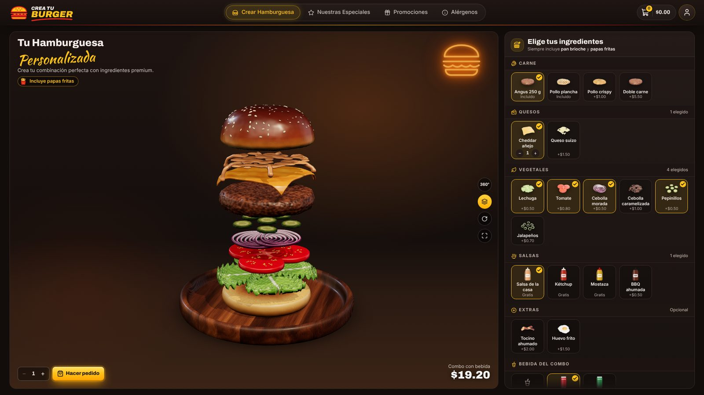
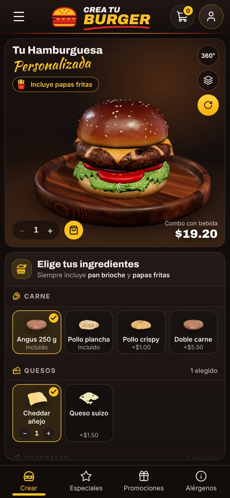
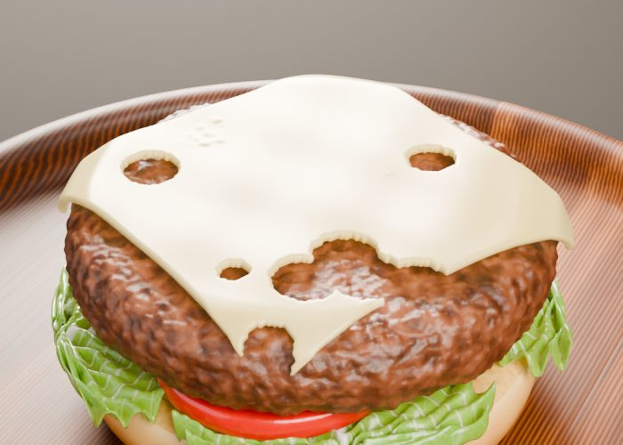
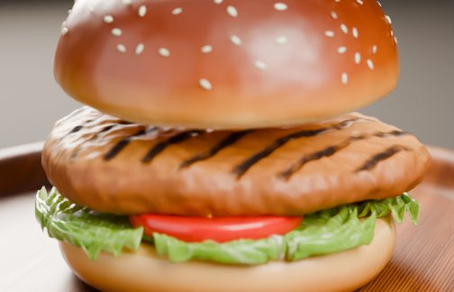

# Crea tu Burger

Configurador 3D de hamburguesas. El cliente elige la proteína, los quesos, los vegetales, las salsas, los extras y la bebida del combo, y la hamburguesa se arma en vivo, capa a capa, con modelos realistas hechos en Blender.

**Demo:** https://burger-nu-six.vercel.app


| Vista por capas | Móvil | Tablet |
| --- | --- | --- |
|  |  |  |

## Qué hace

- **Hamburguesa 3D en vivo.** Cada ingrediente es un modelo GLB que cae y se apila sobre una bandeja de nogal. Se puede girar con el ratón o el dedo, dar una vuelta de 360°, separar las capas ("Vista por capas") y verla a pantalla completa.
- **Proteína a elegir:** carne Angus 250 g, pechuga de pollo a la plancha 250 g o pollo crispy, más la opción de doble carne.
- **Ingredientes en cuadrícula, siempre a la vista:**
  - Quesos: cheddar y suizo, con contador para ración doble.
  - Vegetales: lechuga, tomate, cebolla morada, cebolla caramelizada, pepinillos y jalapeños.
  - Salsas: de la casa, kétchup, mostaza y BBQ, dibujadas como botes.
  - Extras: tocino ahumado y huevo frito.
- **Combo:** siempre incluye pan brioche y papas fritas. La bebida es opcional: Coca-Cola o Sprite, normal o zero (+$2.50), con latas genéricas sin logos.
- **Pedido:** se elige la cantidad (1 a 10 hamburguesas iguales), se ve el precio total y se pulsa "Hacer pedido". En PC es un botón amarillo con brillo animado, y en móvil un botón redondo solo con icono.
- **Diseño oscuro** con letrero de neón, logo propio "Crea tu Burger" y cabecera con navegación tipo píldora.
- **Se adapta a cualquier pantalla y no tiene scroll de página.** La app ocupa exactamente la ventana:
  - Móvil: escena arriba, ingredientes abajo y menú inferior.
  - Tablet: dos columnas.
  - PC: escena grande y panel a la derecha.
  - A partir de 1800 px de ancho todo se escala solo, hasta 4K.
- **Scroll del panel** con títulos de categoría fijos, línea de progreso y barra de scroll dorada.

## Modelos 3D (Blender)

Todos los ingredientes se modelaron en Blender 5.2 con materiales procedurales. Luego se hornearon a texturas de 2048 px (color, rugosidad y normal) y se exportaron a GLB con compresión Draco.

| | | |
| --- | --- | --- |
|  |  |  |
|  |  |  |
|  | | |

Modelos incluidos en `public/models/`:

| Modelo | Archivo |
| --- | --- |
| Pan brioche (tapa con ajonjolí y base) | `bun_top.glb`, `bun_bottom.glb` |
| Carne Angus 250 g | `patty_angus_250g.glb` |
| Pollo a la plancha / crispy | `chicken_grilled.glb`, `chicken_crispy.glb` |
| Cheddar fundido / queso suizo | `cheese_cheddar.glb`, `cheese_swiss.glb` |
| Lechuga, tomate | `lettuce_leaf.glb`, `tomato_slices.glb` |
| Cebolla morada, caramelizada | `onion_red_rings.glb`, `onion_caramelized.glb` |
| Pepinillos, jalapeños | `pickle_slices.glb`, `jalapeno_rings.glb` |
| Tocino, huevo frito | `bacon_strips.glb`, `egg_fried.glb` |
| Salsas | `sauce_house.glb`, `sauce_ketchup.glb`, `sauce_mustard.glb`, `sauce_bbq.glb` |
| Bandeja de nogal | `bandeja_madera.glb` |

Cada GLB tiene la base en `y = 0` y la propiedad personalizada `stack_height` (en metros), que la app usa para saber cuánto sube la pila. Las miniaturas del panel (`public/thumbs/*.webp`) se renderizaron desde esos mismos modelos.

**Fuentes de Blender:** el `.blend` original, las texturas horneadas y los scripts de modelado y horneado están en [`blender/`](blender/README.md). El clon completo pesa unos 250 MB.

## Tecnología

- [Next.js 16](https://nextjs.org) (App Router, Turbopack) y React 19
- Tailwind CSS 4
- [React Three Fiber](https://r3f.docs.pmnd.rs) y drei sobre three.js
- Zustand para el estado del pedido
- lucide-react para los iconos
- Despliegue automático en Vercel desde `main`

## Empezar

```bash
npm install
npm run dev
```

Abre http://localhost:3000. Para comprobar antes de subir: `npx tsc --noEmit`, `npm run lint` y `npm run build`.

## Estructura

```
src/
  app/
    layout.tsx        Fuentes (Archivo, Inter, Kaushan Script) y metadatos
    page.tsx          Página principal
    globals.css       Colores, escalado por pantalla, scroll y botón animado
  components/
    Configurator.tsx  Cabecera, escena, barra de pedido, panel de ingredientes y menú móvil
    BurgerScene.tsx   Escena 3D: luces, bandeja, apilado, animaciones y cámara
    Brand.tsx         Logo, letrero de neón e ilustraciones (papas, latas, botes, iconos)
  lib/
    catalog.ts        Proteínas, ingredientes, precios, bebidas y orden de apilado
    store.ts          Estado del pedido (Zustand)
    models.ts         Qué GLB usa cada ingrediente
public/
  models/             GLB con Draco
  thumbs/             Miniaturas de los ingredientes
  draco/              Decodificador Draco servido por la propia app
docs/images/          Capturas y renders de este README
blender/              Fuentes de Blender: .blend, texturas y scripts
```

## Añadir un ingrediente

1. Modélalo en Blender con la base en `y = 0` y añade la propiedad `stack_height`.
2. Expórtalo con Draco a `public/models/` y añade su ruta en `src/lib/models.ts`.
3. Añádelo a su categoría en `src/lib/catalog.ts`, con el mismo id, su precio, gramos y calorías.
4. Crea su miniatura en `public/thumbs/<id>.webp`.

## Historial del proyecto

1. Boceto web con los primeros modelos: pan brioche y carne Angus.
2. Ingredientes realistas en Blender: cheddar, lechuga, tomate, salsas, tocino y huevo, con texturas horneadas.
3. Selector de proteína: Angus, pollo a la plancha y pollo crispy de 250 g.
4. App Next.js en este repositorio, desplegada en Vercel.
5. Cebolla morada, cebolla caramelizada, pepinillos, jalapeños y queso suizo.
6. Rediseño oscuro "Crea tu Burger" para PC y móvil, a partir de los mockups del cliente.
7. Pantalla completa sin scroll, panel de ingredientes en cuadrícula, combo con papas y bebida, y botón "Hacer pedido".
8. Adaptación automática a monitores grandes, cabecera profesional y scroll mejorado.
