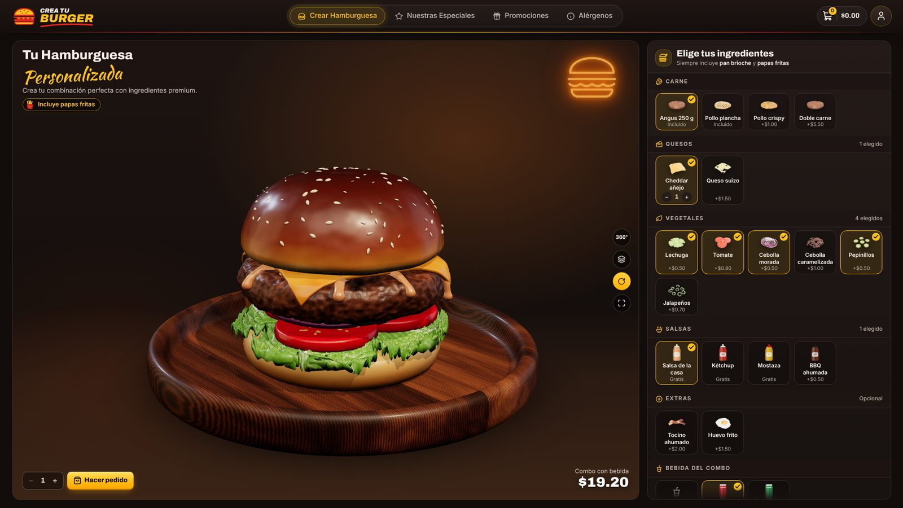
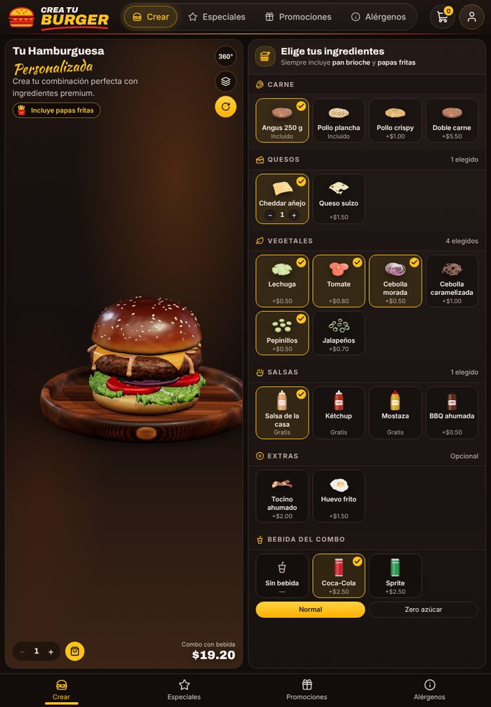
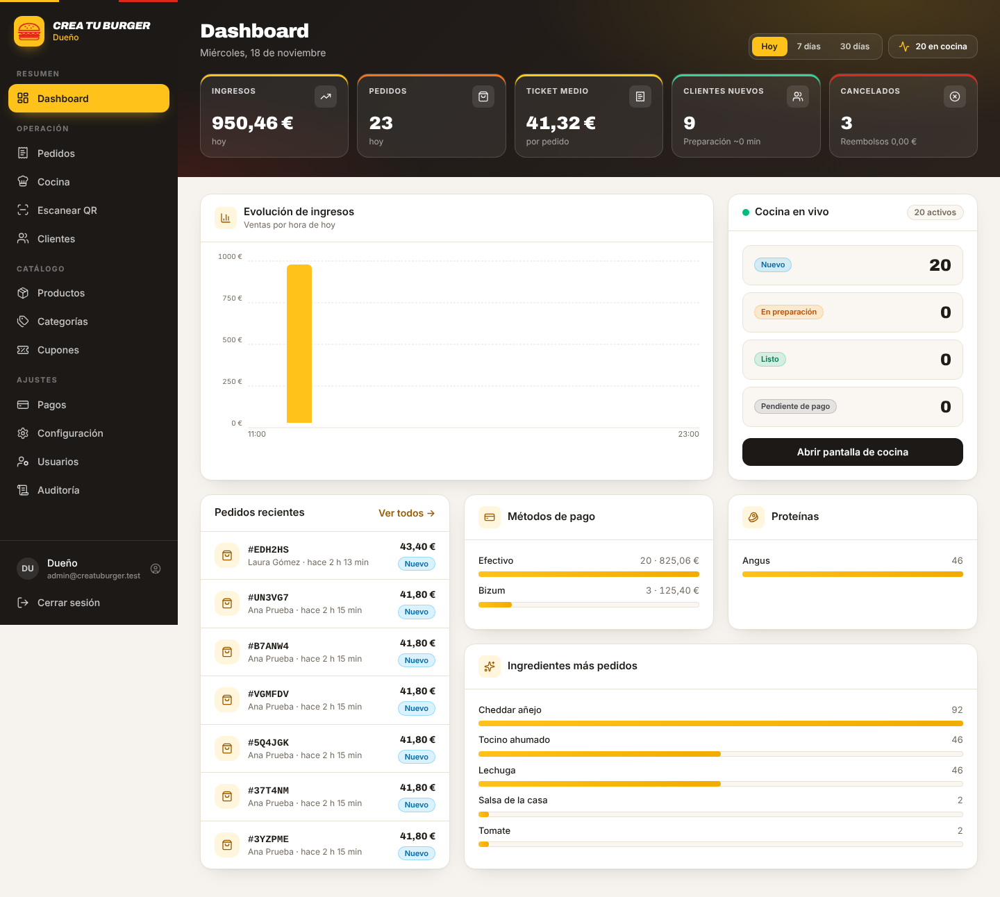
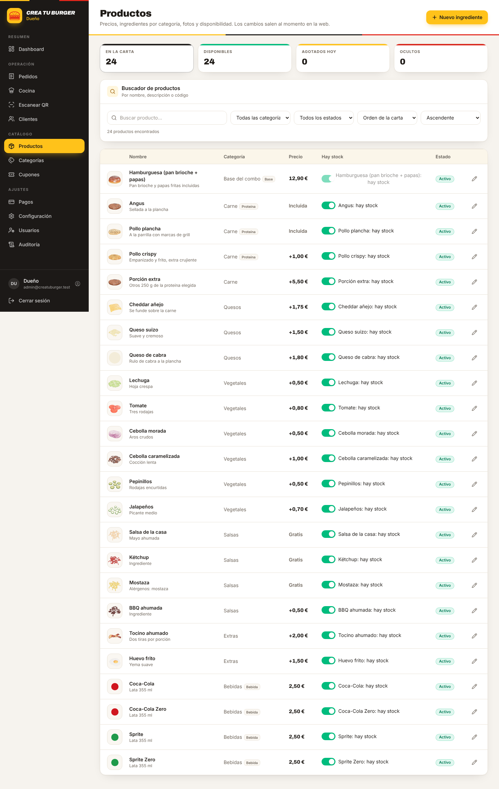
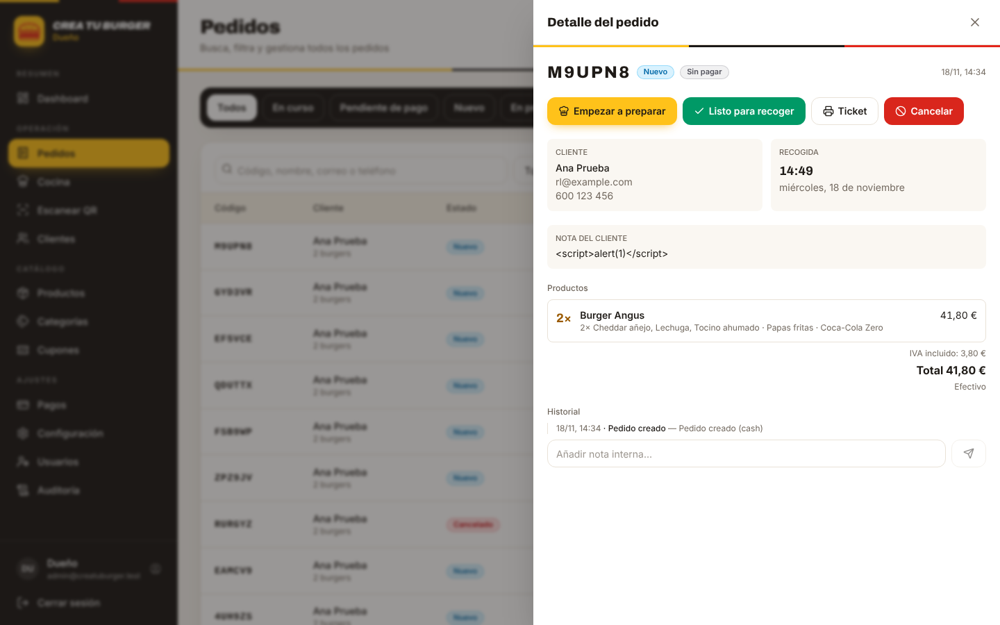
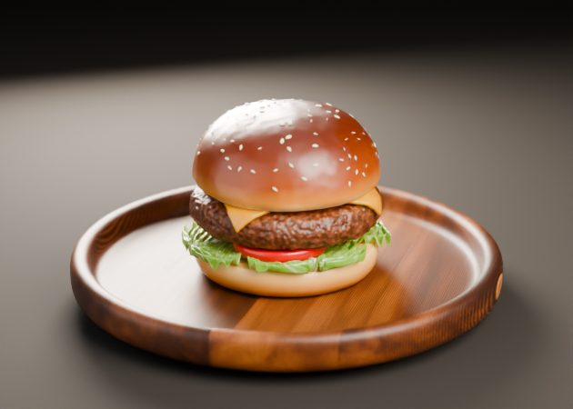
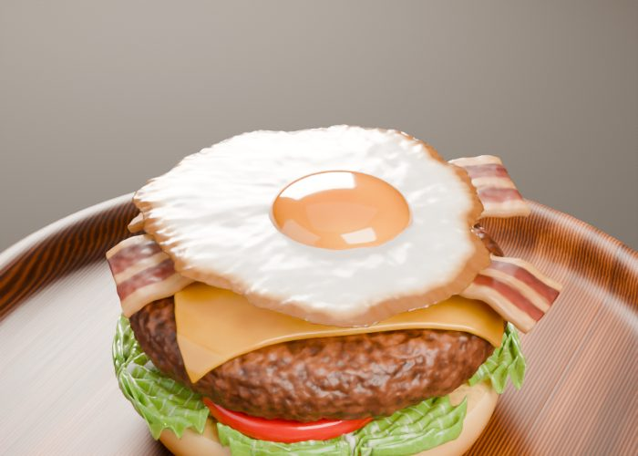
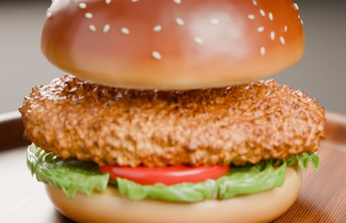
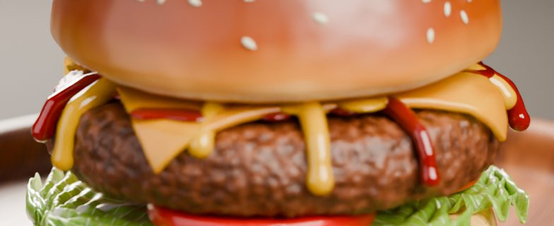
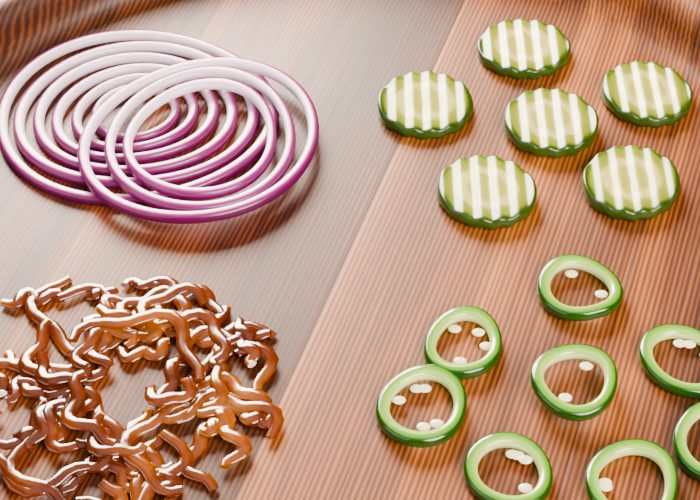

# Crea tu Burger

Configurador 3D de hamburguesas. El cliente elige la proteína, los quesos, los vegetales, las salsas, los extras y la bebida del combo, y la hamburguesa se arma en vivo, capa a capa, con modelos realistas hechos en Blender.

**Demo:** https://burger-nu-six.vercel.app



| Vista por capas | Móvil | Tablet |
| --- | --- | --- |
|  |  |  |

## Qué hace

- **Hamburguesa 3D en vivo.** Cada ingrediente es un modelo GLB que cae y se apila sobre una bandeja de nogal. Se puede girar con el ratón o el dedo, dar una vuelta de 360°, separar las capas ("Vista por capas") y verla a pantalla completa.
- **Proteína a elegir:** carne Angus 250 g, pechuga de pollo a la plancha 250 g o pollo crispy, más la opción de doble carne.
- **Ingredientes en cuadrícula, siempre a la vista:**
  - Quesos: cheddar y suizo, con contador para ración doble.
  - Vegetales: lechuga, tomate, cebolla morada, cebolla caramelizada, pepinillos y jalapeños.
  - Salsas: de la casa, kétchup, mostaza y BBQ, dibujadas como botes.
  - Extras: tocino ahumado y huevo frito.
- **Combo:** siempre incluye pan brioche y papas fritas. La bebida es opcional: Coca-Cola o Sprite, normal o zero (+2,50 €), con latas genéricas sin logos.
- **Carrito:** se elige la cantidad (1 a 10 hamburguesas iguales) y se pulsa "Agregar al carrito". Se pueden añadir hamburguesas distintas. Desde el icono del carrito se cambian cantidades, se quitan hamburguesas y se pulsa "Pagar". El carrito se guarda en el navegador y admite hasta 10 hamburguesas por pedido.
- **Carta en vivo:** precios, nombres, agotados e ingredientes nuevos salen del admin (`/api/catalog`). Si la API no responde, se usa la carta base.
- **Diseño oscuro** con letrero de neón, logo propio "Crea tu Burger" y una cabecera sencilla: logo, carrito y cuenta.
- **Se adapta a cualquier pantalla y no tiene scroll de página.** La app ocupa exactamente la ventana:
  - Móvil: escena arriba e ingredientes abajo.
  - Tablet: dos columnas.
  - PC: escena grande y panel a la derecha.
  - A partir de 1800 px de ancho todo se escala solo, hasta 4K.
- **Scroll del panel** con títulos de categoría fijos, línea de progreso y barra de scroll dorada.

## Pedidos y panel del restaurante (`/admin`)



| Productos | Detalle de un pedido |
| --- | --- |
|  |  |

- **Checkout** desde el botón "Pagar" del carrito: nombre, correo, teléfono, hora de recogida (lo antes posible o por franjas), cupón y método de pago. Precios en euros con IVA del 10 % incluido.
- **Pagos:** tarjeta con Stripe Checkout, Bizum a través del TPV Redsys, PayPal y pago en el local. Cada pasarela confirma el pago con su webhook firmado.
- **Seguimiento del pedido** en `/pedido` con el estado en vivo y el **QR de recogida**. El cliente recibe correos cuando el pedido se confirma, entra en preparación, está listo, se entrega, se cancela o se reembolsa.
- **Panel `/admin`** en tema claro con los colores de la marca (carbón, amarillo y rojo) y menú por secciones:
  - Dashboard: ingresos, pedidos, ticket medio, gráfico por hora o día, cocina en vivo y pedidos recientes.
  - Pedidos con filtros y exportación CSV.
  - Pantalla de cocina que se actualiza sola.
  - Escáner de QR con la cámara.
  - Ticket de 80 mm para imprimir.
  - Productos: buscador, filtros y orden. Se editan precios, agotados, alérgenos, visibilidad y foto.
  - Ingredientes nuevos: se crean dentro de una categoría, con foto, color de muestra y, si se quiere, una capa 3D que reutiliza un modelo existente.
  - Categorías: crear, renombrar, ordenar, ocultar y borrar. Base, Carne y Bebidas son fijas.
  - Clientes, con anonimización RGPD.
  - Pagos y reembolsos.
  - Cupones.
  - Configuración: datos del local, horario, pedidos, SMTP y pasarelas.
  - Usuarios por rol (dueño, administrador, encargado, cocina, caja).
  - Registro de auditoría.
- **Seguridad:**
  - Contraseñas con Argon2id y verificación en dos pasos (TOTP).
  - Sesiones en cookie `__Host-` HttpOnly y SameSite=Strict, con caducidad por inactividad.
  - CSRF con doble envío y comprobación de origen.
  - Bloqueo tras intentos fallidos y límites de peticiones en Redis.
  - Cabeceras CSP y HSTS.
  - QR y enlaces firmados con HMAC.
  - Secretos de pago y SMTP cifrados con AES-256-GCM.
- **Carga alta:**
  - Precios y configuración en caché de Redis.
  - Claves de idempotencia, para que un doble clic no cree dos pedidos.
  - Bloqueo por franja para no pasar del máximo de pedidos por franja; "lo antes posible" pasa sola a la siguiente franja libre.
  - Cola de correos con reintentos.
  - En local, 400 pedidos simultáneos se procesaron a unos 70 por segundo sin errores.

### Puesta en marcha del backend

1. Crea una base de datos Postgres en [Neon](https://neon.tech) o [Supabase](https://supabase.com) y un Redis (por ejemplo [Upstash](https://upstash.com)).
2. Copia `.env.example` a `.env.local` y rellénalo. En Vercel, pon las mismas variables en Settings → Environment Variables.
3. Añade también en Vercel `ADMIN_EMAIL` y `ADMIN_PASSWORD` (mínimo 10 caracteres, con letras y números). En cada despliegue, `npm run build` aplica las migraciones, carga el catálogo y las categorías sin pisar precios, categorías ni orden editados en el admin y crea ese usuario dueño si aún no existe (si ya existe, le pone la contraseña de `ADMIN_PASSWORD`). Cuando ya puedas entrar, borra `ADMIN_PASSWORD` para que un despliegue no deshaga un cambio de contraseña hecho en el admin.
   En local: `npm run db:migrate` y `npm run db:seed`.
4. Entra en `/admin`, activa la verificación en dos pasos en "Mi cuenta" y configura el local, el SMTP y las pasarelas en "Configuración".
5. Registra las URL de webhook que muestra cada pasarela en Configuración → Pagos.

`vercel.json` programa `/api/cron` una vez al día, el máximo del plan Hobby. Ese cron cancela los pedidos sin pagar, reintenta correos y limpia sesiones. Mientras haya alguien con la pantalla de cocina abierta, esas tareas también se hacen cada minuto.

Pruebas: `node scripts/api-test.mjs` (56 comprobaciones de la API y la seguridad) y `node scripts/load-test.mjs` (carga), con el servidor en marcha.

## Modelos 3D (Blender)

Todos los ingredientes se modelaron en Blender 5.2 con materiales procedurales. Luego se hornearon a texturas de 2048 px (color, rugosidad y normal) y se exportaron a GLB con compresión Draco.

| | | |
| --- | --- | --- |
|  |  |  |
|  |  |  |
|  | | |

Modelos incluidos en `public/models/`:

| Modelo | Archivo |
| --- | --- |
| Pan brioche (tapa con ajonjolí y base) | `bun_top.glb`, `bun_bottom.glb` |
| Carne Angus 250 g | `patty_angus_250g.glb` |
| Pollo a la plancha / crispy | `chicken_grilled.glb`, `chicken_crispy.glb` |
| Cheddar fundido / queso suizo | `cheese_cheddar.glb`, `cheese_swiss.glb` |
| Lechuga, tomate | `lettuce_leaf.glb`, `tomato_slices.glb` |
| Cebolla morada, caramelizada | `onion_red_rings.glb`, `onion_caramelized.glb` |
| Pepinillos, jalapeños | `pickle_slices.glb`, `jalapeno_rings.glb` |
| Tocino, huevo frito | `bacon_strips.glb`, `egg_fried.glb` |
| Salsas | `sauce_house.glb`, `sauce_ketchup.glb`, `sauce_mustard.glb`, `sauce_bbq.glb` |
| Bandeja de nogal | `bandeja_madera.glb` |

Cada GLB tiene la base en `y = 0` y la propiedad personalizada `stack_height` (en metros), que la app usa para saber cuánto sube la pila. Las miniaturas del panel (`public/thumbs/*.webp`) se renderizaron desde esos mismos modelos.

**Fuentes de Blender:** el `.blend` original, las texturas horneadas y los scripts de modelado y horneado están en [`blender/`](blender/README.md). El clon completo pesa unos 250 MB.

## Tecnología

- [Next.js 16](https://nextjs.org) (App Router, Turbopack) y React 19
- Tailwind CSS 4
- [React Three Fiber](https://r3f.docs.pmnd.rs) y drei sobre three.js
- Zustand para el estado del pedido
- Postgres (Neon o Supabase) con Drizzle ORM, y Redis (ioredis)
- Zod para validar, Argon2id y TOTP para el acceso, Nodemailer para el correo
- Stripe, PayPal (Orders v2) y Redsys (Bizum)
- lucide-react para los iconos
- Despliegue automático en Vercel desde `main`

## Empezar

```bash
npm install
npm run dev
```

Abre http://localhost:3000. Para comprobar antes de subir: `npx tsc --noEmit`, `npm run lint` y `npm run build`.

## Estructura

```
src/
  app/
    layout.tsx        Fuentes (Archivo, Inter, Kaushan Script) y metadatos
    page.tsx          Página principal
    globals.css       Colores, escalado por pantalla, scroll y botón animado
    admin/            Panel del restaurante (login, resumen, pedidos, cocina, escáner, etc.)
    pedido/           Seguimiento del pedido con QR
    api/              API pública, webhooks de pago, cron y API del admin
  server/             Backend: BD, Redis, auth, pedidos, pagos, correo, configuración
  proxy.ts            Protege /admin
  components/
    Cart.tsx          Carrito: cantidades, total y botón Pagar
    Checkout.tsx      Formulario de pedido y pago
    Configurator.tsx  Cabecera, escena, barra de pedido y panel de ingredientes
    BurgerScene.tsx   Escena 3D: luces, bandeja, apilado, animaciones y cámara
    Brand.tsx         Logo, letrero de neón e ilustraciones (papas, latas, botes, iconos)
  lib/
    catalog.ts        Proteínas, ingredientes, precios, bebidas y orden de apilado
    live.ts           Carta en vivo desde el admin (precios, agotados, ingredientes nuevos)
    store.ts          Estado del pedido y carrito (Zustand)
    models.ts         Qué GLB usa cada ingrediente
public/
  models/             GLB con Draco
  thumbs/             Miniaturas de los ingredientes
  draco/              Decodificador Draco servido por la propia app
docs/images/          Capturas y renders de este README
blender/              Fuentes de Blender: .blend, texturas y scripts
drizzle/              Migraciones SQL
scripts/              Migrar, cargar datos, pruebas de API y de carga
```

## Añadir un ingrediente

**Desde el admin (sin código):** en Productos → "Nuevo ingrediente", elige la categoría, el precio, la foto y, si quieres que se vea en 3D, la capa que reutiliza ("Loncha de queso suizo", "Salsa roja", etc.). Sale en la web en unos segundos.

**Con un modelo 3D propio:**

1. Modélalo en Blender con la base en `y = 0` y añade la propiedad `stack_height`.
2. Expórtalo con Draco a `public/models/` y añade su ruta en `src/lib/models.ts`.
3. Añádelo a su categoría en `src/lib/catalog.ts`, con el mismo id, su precio, gramos y calorías.
4. Crea su miniatura en `public/thumbs/<id>.webp`.
5. Despliega: el ingrediente se crea en la base de datos y desde entonces se gestiona en el admin.

## Historial del proyecto

1. Boceto web con los primeros modelos: pan brioche y carne Angus.
2. Ingredientes realistas en Blender: cheddar, lechuga, tomate, salsas, tocino y huevo, con texturas horneadas.
3. Selector de proteína: Angus, pollo a la plancha y pollo crispy de 250 g.
4. App Next.js en este repositorio, desplegada en Vercel.
5. Cebolla morada, cebolla caramelizada, pepinillos, jalapeños y queso suizo.
6. Rediseño oscuro "Crea tu Burger" para PC y móvil, a partir de los mockups del cliente.
7. Pantalla completa sin scroll, panel de ingredientes en cuadrícula, combo con papas y bebida, y botón "Hacer pedido".
8. Adaptación automática a monitores grandes, cabecera profesional y scroll mejorado.
9. Backend con Postgres y Redis: pedidos, pagos en euros (Stripe, Bizum, PayPal y efectivo), QR de recogida, correos de seguimiento y panel `/admin`.
10. Admin en tema claro, gestión de categorías e ingredientes desde el panel, y carta en vivo en la web.
11. Carrito: "Agregar al carrito" y pago desde el carrito.
12. Cabecera sin el menú de secciones (Crear, Especiales, Promociones, Alérgenos) ni la barra inferior del móvil.
